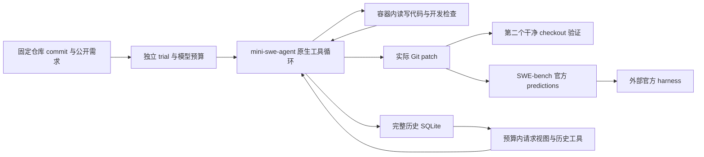

# 设计与后续实验

目标是把“给出一个仓库需求”变成可审查的文件改动和独立验收证据。模型的自然语言承诺不是交付物；运行记录、实际 Git patch 和评分报告才是可核对的结果。

## 为什么复用成熟运行时

mini-swe-agent 已有 provider 适配、原生工具轮次、成本和退出协议。重新实现这些基础循环容易只在自建假模型上成立。因此固定 2.4.6，直接继承真实 DefaultAgent，用契约测试验证扩展入口。创新集中在可验证的上下文选择与仓库交付，而不是为基础循环换名称。

模型请求视图与完整事件分开：输出很长时缩短请求视图，原始观察仍保存在 SQLite；模型可通过 search/read 找回被省略的内容。system、原始需求和最新完整工具轮次始终保留；连这些必要内容都放不进预算时，在请求前明确停止，避免发送残缺工具协议。

note 是 Agent 的任务笔记，可以提升跨轮连续性，但内容未经过验证。它与仓库事实、命令观察和独立评分有不同来源标记。当前仅有任务内检索，没有跨任务知识库或学习式排序。

## 交付失败也必须留下证据

每个 trial 拥有独立 checkout、模型对象、容器和输出目录。重复运行创建新 trial；不自动重发失去响应的模型请求。限时、超量输出和清理失败都属于失败结果。普通仓库模式会尽量保留失败前的部分 patch，但这些补丁不冒充正式提交进入 predictions。

宿主机 Git 捕获需要额外保护：容器内禁止改 `.git`，捕获时忽略宿主 Git 配置、外部 diff、textconv 与 fsmonitor。新增文件通过 intent-to-add 进入实际 binary diff。独立验收先应用到另一个固定 commit checkout，避免只在 Agent 留下的脏工作区通过检查。

SWE-bench 的 Agent 只读公开 task manifest。gold patch、隐藏测试与官方 grader schema 留在评分环境。结果聚合必须核对实例 ID、模型路径、实际 patch 和对应报告；缺失报告保持未知。

## 如何证明上下文策略有价值

下一步实验应先固定任务列表与数据 hash，记录实际源码 commit、模型权重 digest、镜像 SHA、请求与命令预算，随后对每题分别运行 baseline、recent、retrieval。每种策略使用相同模型和预算，并保留每个重复 trial，包括未提交、超时、模型失败与清理失败。

需要比较的指标是官方 resolved、全部真实尝试的成功比例、provider 实际 token/费用、耗时、超预算停止、公开验证和检索调用。仅“压缩了多少 prompt”无法证明交付能力提升。token 未报告时保留 unknown；本地 Ollama 不从 token 数推算美元费用。

正式结论须报告样本量、逐任务结果和重复 trial 的不确定性。当前项目没有宣称上下文策略提高成功率，也没有宣称已取得 SWE-bench 分数。

## 与岗位要求的对应

| 岗位工作 | 可展示的实现与讨论点 |
|---|---|
| AI Native 研发工具 | 固定真实仓库需求、生成文件改动、导出 Git patch、独立验收 |
| Agent 框架与模型适配 | 扩展成熟 DefaultAgent，复用 provider 协议，验证真实上游契约 |
| 编排调度 | 有界并发、独立 trial、失败留痕和资源回收；不宣称分布式调度 |
| 上下文工程 | 完整历史和请求视图分离、工具轮次原子性、硬预算和历史回查 |
| 评测与持续调优 | 无答案任务冻结、官方评分对接、失败分母和补丁报告绑定 |
| 系统设计 | 宿主/容器执行边界、Git 回调风险、未知状态和可重复实验设计 |

这些是实现内容，性能改进仍需要真实模型与官方实验数据支持。面试时可以解释选择、边界和失败路径，不应将未运行的评测写成简历成果。
