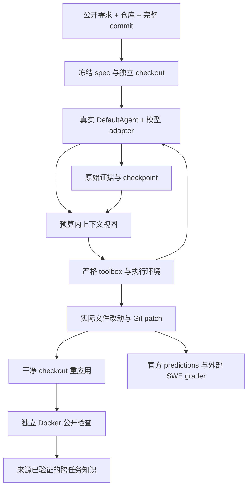

# 做了什么、怎么做、遇到什么问题

这个项目解决的业务问题是：给编程 Agent 一个真实仓库需求，怎样让它完成可审查的文件修改，并明确判断交付是否成立。交付物由固定任务、实际 Git patch、运行轨迹和独立验收组成；最后一句“已经完成”只是一条 Agent 回复。

初版已经具备真实仓库与 SWE-bench 交付接口。本次继续补齐 Skills、跨任务知识库、持久调度和断点恢复，并接入直接 Ollama 推理及受限源码编辑环境。真实实验和评分状态由 [experiments](../experiments) 记录；这里解释实现与证据边界，不预先填写尚未取得的性能数字。

源码提交 a81d882 的实际 CI 已通过 Windows/Linux 各 196 项、0 skip，真实 Docker 和独立 verifier 也通过。三轮六案例加一个单案例共保留 19 次固定 CI 真实模型尝试：10 次公开开发任务、9 次官方任务，Submitted 为 0，公开交付为 0/10。这个项目目前能展示完整工程实现和可核验的失败分析，没有取得模型官方 resolved 分数。逐题 usage、补丁和 CI 来源见 [验证记录](validation.md)。

## 复用了什么，自主实现了什么

选择 [mini-swe-agent 2.4.6](https://github.com/SWE-agent/mini-swe-agent/tree/04d809ceab9df28f9adaed044884180159172930) 作为实际 runtime，继承它的 DefaultAgent，复用模型/环境协议、查询与执行循环、Submitted 和 FormatError 等控制流。版本由真实包 metadata 校验。这样可以验证增强在成熟运行时上成立，而不是只与自己写的 mock 配合。

[OpenHands SDK](https://github.com/OpenHands/software-agent-sdk/tree/33044182505244749928644a4643368a9e998ee7) 的上下文事件设计提供了参考：保留完整事件，只改变模型当前看到的视图。没有引入整个 SDK 或把它的实现改名。

[Agent Skills specification](https://agentskills.io/specification) 指导 SKILL.md 的名称、描述、目录与渐进披露；本项目新增自己的只读 registry 与研发 Skills。[SWE-bench 固定 harness](https://github.com/SWE-bench/SWE-bench/tree/02e7a74ffd0b707aab73d203fe87bdc7c76afc8e) 定义官方数据和评分接口；本项目负责公开输入冻结、运行、预测导出和报告身份核对。

新增的核心工程位于 skills/knowledge、checkpoint/recovery、scheduler/server/worker、runtime/file_environment、ollama_model、repository 和 CLI/toolbox。模型适配的成熟部分仍属于上游；直接 Ollama adapter 与这些交付模块由本项目实现。

## 一次真实任务怎样完成

CLI 先验证输入：完整 40 字符 commit、仓库和 task ID 格式、明确镜像和预算。新 trial 建立新目录，保存 task/config/upstream/代码/Skills 指纹。仓库切到 detached commit 并核对 HEAD；任务结束时再次核对，Agent 不得通过移动 HEAD 隐藏改动。

模型产生工具动作，工具拦截层区分历史、Skills、知识检索与真实执行。Docker backend 在受控容器中执行；files backend 仅解释文件操作，永远不执行模型生成的宿主 shell。每个 trial 有自己的模型对象、工作区、运行状态与证据。

补丁取自实际文件系统，先用 intent-to-add 纳入新增文件，再生成 binary diff。第二个干净 checkout 应用补丁；检查执行环境与 Agent 编辑环境分离。官方任务的隐藏验收则交给独立 SWE-bench grader。

## 上下文、Skills 与知识怎样协作

### 完整证据与当前请求分开

SQLite 保存每条消息和上游 `extra.raw_output`。request-views 另存模型真正看到的内容，以及选入、排除和缩短的来源 ID。缩短日志不删除原始证据，Agent 可以 search/read 分页找回。

三种策略的区别：baseline 保留完整历史，超预算就停止；recent 保护必要消息、保留最近完整轮次并缩短长工具输出；retrieval 在此基础上按任务相关性补回旧轮次。assistant 的 tool calls 与全部对应结果作为一个不可拆分的组，避免孤立调用或缺失结果破坏 provider 协议。

system、原始需求和最新完整轮次始终受保护。如果这些内容也无法容纳，系统在调用模型前停止，并保持计数准确。预算使用明确标记的保守 UTF-8 字节估算；实际用量读取 provider response。不能把估算值或缺失 usage 当成实测 token 收益。

`delivery-history note` 最多保存少量简短笔记；它属于 Agent 自述，没有自动获得“已验证事实”的地位。

### Skills 的渐进披露

SkillRegistry 在启动时读取 SKILL.md 元数据并计算资源 hash，只向模型先提供 name/description 概要。Agent 确认适用后使用 delivery-skill read 读取正文，再按需读取 references。渐进披露控制的是模型看到的内容，不代表启动时完全不读取资源文件。资源目录和 hash 在启动时冻结；修改后读取会失败，防止运行中悄悄更换指导内容。

内置 python-regression 把需求转成可观察的回归检查，提醒单次迭代、空输入和不可哈希元素等具体问题；patch-delivery 指导最后的文件和验收证据检查。支持额外的操作者配置 roots，拒绝目录穿越、清单外路径和 symlink 逃逸。资源可以被阅读，但不会自动执行其中脚本，也不会因 allowed-tools 文本扩大权限。

### 跨任务知识与验证来源

知识记录包含 task/repo/base commit、来源引用、内容 hash、验证证据、更新时间与过期时间。SQLite WAL 和短事务支持多进程写入；主记录与 FTS 索引原子更新，稳定来源 ID 用于去重和回查。

默认检索尚未过期的 verified 记录。run 导入核对 task fingerprint、spec/result provenance 和实际 patch；只有真实模型模式提交、补丁独立应用且全部公开检查匹配并通过，才提升为独立公开检查已验证。Agent narrative、notes 与单独的 official_resolved 自述不会被当成验收证据。哈希用于发现错配；操作者仍须信任导入的 harness 来源。

检索使用 FTS5/BM25，可选 BGE 语义向量。向量空间以 Ollama 模型 digest 固定，维度和有限数值受检查。BM25 与 cosine 排名通过 RRF 合并，保留每条结果的两路排名。服务失败时保留词项检索与错误类型，可用 index_pending 重建。它是固定排序，没有训练出的学习排序模型。

namespace 参与 ID hash，所有 SQL 读写精确限定 namespace。当前任务的知识在 search 和 read 都被拒绝，避免同题先前补丁污染评测。不同仓库、不同 commit 的经验仍必须依据来源判断适用性，最后重新验证。

### 真实 BGE 检索中的一次失败

实际使用本机 bge-m3，模型 digest 为 `7907646426070047a77226ac3e684fbbe8410524f7b4a74d02837e43f2146bab`，向量 1024 维。语料是三个公开文档的独立摘要，记录保持 unverified，并显式检索参考资料；没有当前 coding task 的答案。

第一次查询 `one shot traversal` 没有词项命中，但 iterator 文档只排第二，SQLite 文档排第一，严格 top-1 检查失败。这个结果保留在 [初次记录](../experiments/semantic-search-initial.json)。更明确的查询 `Do not scan this collection twice because it gets depleted` 仍然词项 0 命中，语义检索将 iterator 排第一，namespace/current-task 检查也通过，见 [真实 smoke](../experiments/semantic-search.json)。

这说明真实嵌入和混合检索路径已经工作，也说明短查询会歧义。三篇语料和两条探针不能估计总体检索质量，更不能证明编程成功率提高。

## 检查点为什么不能只保存聊天记录

一次操作会经过三个状态：先持久化 pending，再调用 provider/环境，拿到确定结果后持久化 result，最后将它提交到 Agent 消息状态。checkpoint 原子写入、fsync、hash 校验，并使用本机 OS writer lock，防止两个进程同时恢复。

它保存消息、稳定 source ID、笔记、调用与成本、连续格式错误、实际 usage、原始启动时间和运行绑定。恢复不清零预算，停机时间仍计入 wall-time。代码、任务、Skills、模型和容器身份改变时拒绝接续旧 trial。

如果进程在 result 已保存、消息尚未提交之间崩溃，恢复消费已保存结果，不重复模型请求或命令。多 action 的 assistant 轮次按顺序回放已完成部分，继续尚未执行的部分。历史 SQLite 与 checkpoint 不是同一个事务，所以恢复用已验证 checkpoint 重建历史索引，避免重复 source ID。

如果进程死在远程调用期间，只留下 pending，就无法确定是否已计费或改动文件。默认停止；显式 retry 记录这个决定，并保留 unknown_requests/usage 不完整状态。系统不会声称这个场景 exactly-once。

Docker 重新接入还检查真实 container/image、workspace、HEAD、RW/RO 挂载、网络、用户、资源与临时目录。只有原会话仍符合绑定才恢复。远端主机完全消失时，coordinator 能重新排队任务，但不能替它证明孤儿容器已销毁。

## 从线程 batch 到独立 worker

有界线程 batch 适合单机小规模尝试。新增 HTTP coordinator 将任务队列和 attempt 状态持久化，worker 使用 register/claim/heartbeat/complete API；每台 worker 持有自己的模型 endpoint、Skills、KB 和工作目录，不需要共享盘。

claim 使用 SQLite BEGIN IMMEDIATE，在同一事务分配 attempt 和租约。每次领取有递增 generation 和随机 token；心跳与完成提交同时核验它们。过期 worker 即使随后成功也不能覆盖新的任务代。相同租约、相同结果 hash 可以重复提交，异内容提交冲突。

取消与租约丢失触发 cooperative cancellation，停止后续命令并关闭登记的任务容器。已发送的 provider 请求无法撤回，受请求 timeout 约束。coordinator 持久化 queued/leased/succeeded/failed/cancelled 状态，重启后保留 accepted results 和失败 attempts。

系统支持跨机器部署协议；目前真实集成验证用本机两个独立 Python worker 进程，通过真实 loopback HTTP 完成多个长于租约的任务、心跳、取消和 crash 后重领。这属于调度验证，不是 LLM 成功率，也不是物理多机压力测试。共享 token/TLS 支持可信部署，尚无多租户 ACL 或多副本 coordinator。

## 为什么增加直接 Ollama 与 files backend

本机具备 Ollama 模型，但完整通用 provider 依赖安装缓慢，Docker Linux engine 也出现不可连接。新增直接 HTTP adapter 在真实 DefaultAgent 模型协议上调用 `/api/chat`，保存原始 provider response、实际 prompt/eval counts 和模型 digest。JSON mode 接受严格 command object；tools mode 使用原生函数调用。确定的格式错误进入上游 FormatError 控制流，丢失响应保留为未知。

本地模型没有可验证的美元价格，所以标记 unpriced_local/cost_unknown，不能从 tokens 猜费用。这个 adapter 发起真实模型请求，没有用固定回复代替模型。

files backend 把模型动作限定为来源目录内的读、搜索、写、追加和精确替换。禁 Git 元数据、路径逃逸、链接与设备/替代流等危险路径，并限制命令/文件/输出大小。因为不运行任意代码，本机可先形成真实补丁，再把补丁交给独立 Linux Docker 或官方 grader。这个后端不能假装已经运行测试。

真实实验还暴露了工具设计本身的问题。第一轮模型在仓库根目录创建同名模块，未接入包导出；因此增加有界的真实 Python 路径 inventory 和目录 search，帮助先定位现有包。第二轮把 read 显示的行号写进源码，还用短片段清空了数千行模块和测试。随后把 read 改成原始选中源码，范围元数据单独保存；write 改为独占创建新文件，已有文件必须精确 replace 或 append，契约测试核对拒绝覆盖后内容保持不变。

这些修改的真实结果也保留了失败：file-tools-v3 的 recent 单案例进行了 16 次真实调用、21800/1216 输入/输出 tokens，运行 354.738 秒后 LimitsExceeded；306-byte patch 只追加包自导入，公开检查因循环导入失败。第三轮六个案例也没有提交，三个开发检查仍因循环导入失败，三个官方任务为空 patch。最后七份补丁仅有增加或为空，没有再出现整文件删除和行号污染；但没有上传原始动作，不能由最终补丁证明每次 write 都被拒绝，也不能称为交付成功。相同 run ID 出现在不同轮次时，用实验目录与 Actions provenance 保留各次尝试，避免错误去重。

## 具体问题与修复

| 问题 | 影响 | 修复 |
|---|---|---|
| 普通 diff 漏掉新增文件 | 输出的补丁不完整 | intent-to-add 后生成实际 binary diff，测试新增/修改/删除和干净应用 |
| 截断工具调用和结果 | provider 历史协议残缺 | 以完整 tool loop 选择；预算不足在请求前停止 |
| prompt 片段被当成全部证据 | 无法回查早期错误 | raw output 单独保存，来源 ID 与分页读取 |
| 只结束 docker exec 客户端 | 容器中的旧进程可能继续改代码 | 同步停止整个会话，拒绝后续执行；清理失败明确保留 |
| 启动前没有容器 ID | 客户端超时后可能遗留容器 | 预分配容器名，失败按已知名字清理 |
| Git metadata 可修改 | 宿主捕获可能触发 Git 回调 | Docker .git 只读、宿主配置回调限制；files 路径也保护大小写与特殊路径 |
| Linux 丢 capabilities 后无法写挂载 | 真 Docker 与替身测试不同 | 使用匹配宿主的 UID/GID 与可写 HOME，再跑实际容器检查 |
| Windows 临时路径有别名 | 同一目录被测试误判为不同 | fixture 与生产路径都规范化，并保留诊断类型 |
| KB 自述冒充 verified | 错误经验持续传播 | 只读模型工具、来源 hash、独立公开检查核对和 expiry |
| 同题知识回流 | 对照实验泄漏先前答案 | 当前 task ID 同时在词项、语义、直接 read 路径排除 |
| 新建同名根模块而未接入包 | 第一轮补丁可应用，但公开检查 ImportError | 有界源码路径 inventory、目录 search 与定位包/导出入口的提示；后续仍以实际检查验收 |
| response 已返回但进程崩溃 | 盲目重试造成重复调用/命令 | pending/result/commit checkpoint，已知结果回放 |
| 旧 worker 晚到提交 | 覆盖新一代结果 | generation/token fencing 和 exact completion hash |
| 只统计提交结果 | 未提交失败从分母消失 | predictions 另附全真实 attempts sidecar，报告两种分母 |
| 读取的行号被复制进源码 | 第二轮真实补丁出现 `1:` 前缀，Python SyntaxError | files read 返回原始源码，范围信息单独记录，避免混入可复制内容 |
| 用读取片段覆盖整个文件 | 第二轮将数千行模块和测试缩成十几行 | write 只创建新文件，已有文件使用精确 replace/append；拒绝操作不改变原文件 |
| 无公开检查被当成公开失败 | 官方任务混入开发验收分母 | 保留全部 attempts，公开指标只用 eligible 分母；无检查状态为 null/unknown |
| 异常退出缺少顶层 usage | 误写零 tokens 或精确总成本 | 回查实际 response usage，报告已知用量；FormatError 缺失用量与 complete=false 保留 |
| 官方 CLI 保留旧名字但内部已是 v5 | 旧数据字段不足而无法评分 | 固定数据 revision，私有来源保留 image/eval_script/log_parser/eval_type，公开输入去答案 |

真实测试结果、后续 CI 修复和模型逐题记录见实验报告；这里不将“实现了处理分支”当成“所有运行环境都已验证”。

## 怎样评测才有意义

官方 Verified 原始 500 条 Parquet 已实际下载，并核对远程 revision 与 LFS SHA。选择 requests/flask 三题时只使用 repo 和公开需求长度，gold/test/eval script 留在 ignored data。公开例子只有 Agent 必需字段。三个官方 OCI manifests 也实际查询成功；它们各有约 GB 级压缩层，轻量仓库不等于轻量镜像。

编程 Agent 实验必须同时保留提交状态、补丁可应用、公开检查和官方 resolved。官方 report 的 task ID、模型路径与 patch.diff 必须对应实际预测；缺失或错配报告保持 unknown。失败尝试留在全部 attempts 分母，不能只挑提交成功的那批。

模型官方 gate 已真实运行：接收到 3 次未提交尝试后返回 no_submissions，complete=false、resolved rate=null。它验证了没有提交时的真实流程，没有制造官方 0% 分数。另一个官方 harness 契约实际用固定 v5.0.2 源码、冻结 Parquet 和官方 requests-2931 镜像，应用人工构造的新增文本文件 patch，执行评估并导出真实布尔报告。结果为 patch_applied=true、resolved=false、infra_failure=false，exit=0，59.012 秒；summary 明确 fixture=true、llm_calls=0、model_score_eligible=false。这证明官方执行链路工作，人工 patch 未解决 Issue，不进入 19 次模型尝试、tokens 或模型 resolved 统计。实际报告见 [官方契约](../experiments/official-harness-contract/summary.json) 与 [模型 gate](../experiments/official-gate-v02/summary.json)。

baseline/recent/retrieval 对照固定任务、模型 digest、预算、seed 和实现指纹。baseline 与 recent 同时改变历史选择和长输出视图，所以检验 retrieval 的增量应重点比较 recent/retrieval。一次小样本实验不能证明普遍提升；provider 生成也不保证完全确定。还应看实际 usage、耗时、超预算与失败原因，不能用 prompt 变短直接推导交付提高。

前两轮分别使用 1.5B/10 steps 和 3B/24 steps，同时改变了路径提示与工具；第三轮修改文件编辑契约，单案例又使用 16 steps。因此它们是保留全部失败的工程迭代记录，不是单因素因果实验。十次开发任务的公开检查均未通过，九次官方任务没有模型分数。BGE 三篇语料探针、Docker/恢复 fixture、零模型调用的官方 fixture 和真实模型实验各自有不同证据范围；本机独立 worker 的 HTTP 验证也不能写成物理多机生产验证。

项目当前的具体结果与最终测试计数以 [experiments 报告](../experiments)、[验证记录](validation.md) 和匹配源码提交的 Actions 为准。Docker functional smoke、确定 fixture 的恢复/调度协议、真实 BGE 检索、真实模型补丁与官方评分是不同证据层。

## 与岗位要求的对应

这些实现可以围绕一个完整业务故事展开：拆解需求、选择可复用 runtime、配置 Skills、管理上下文与历史、受控执行、持久调度、恢复失败、生成实际补丁，再用独立验收评价结果。能解释原子性、租约、来源可信度和失败分母，才是工程设计能力的展示。

简历可以写已经实现并验证过的模块和具体实验，但模型成功率、时间收益和 benchmark 成绩应使用实际报告。未训练学习排序、未实施多副本协调器和多租户体系，属于明确的规模与设计边界，不能用已有 SQLite/HTTP 功能替代这些结论。
